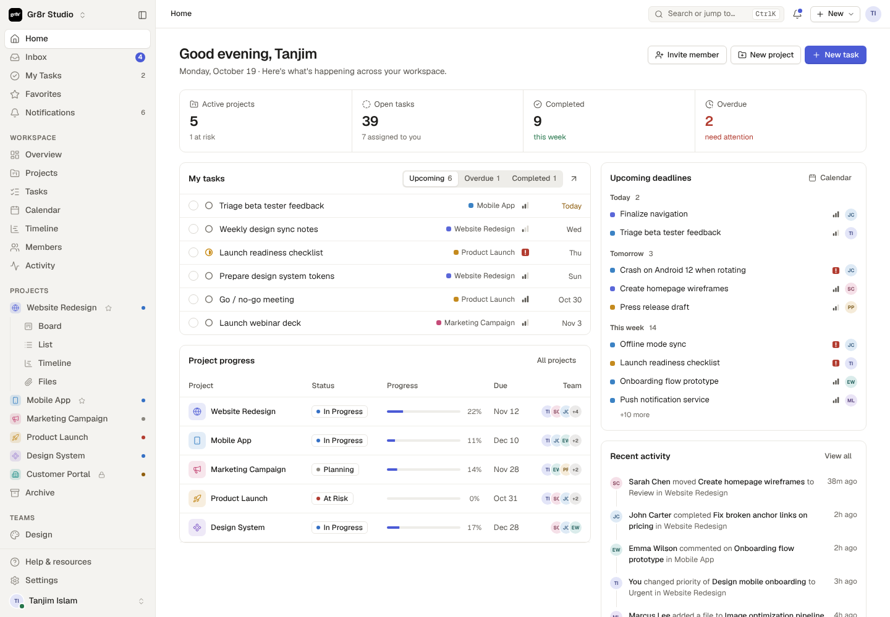

# Gr8r UI

Приложение [Gr8r Studio](https://github.com/gr8rstudio/gr8r-studio) (бесплатный шаблон Setproduct), перенесённая на React.
Внешний вид, токены и CSS взяты из оригинала. Поведение, которое в оригинале было написано вручную (меню, выпадающие списки,
диалоги, тултипы, табы, фокус и клавиатура), теперь берут на себя примитивы [Radix](https://www.radix-ui.com).
Проект совместим с [shadcn/ui](https://ui.shadcn.com): компоненты, добавленные через `npx shadcn add …` (из `apps/web`), сразу выглядят как Gr8r.



## Запуск

Репозиторий — монорепозиторий на Bun workspaces (подробности в [docs/architecture.md](docs/architecture.md)):
фронтенд в `apps/web`, бэкенд в `apps/api` и `apps/worker`, общий код в `packages/`.

```bash
bun install
bun run dev        # всё сразу: api (:3000) + worker + web (http://localhost:5173) — нужен PostgreSQL, см. «Бэкенд»
bun run dev:web    # только фронтенд (ходит в API через прокси Vite /api → VITE_API_PROXY, по умолчанию http://localhost:3000)
bun run build      # проверка типов + production-сборка фронтенда
bun run typecheck  # tsc во всех пакетах
bun test           # тесты бэкенда (нужен PostgreSQL, см. «Бэкенд»)
```

Фронтенд работает на API: вход, воркспейсы, данные и обновления в реальном времени — с сервера (вход после `bun run db:seed`: `demo@gr8r.dev` / `demo1234`). В браузере остаются только настройки просмотра (тема, плотность, свёрнутый сайдбар, плавающие окна). Как это устроено — в [docs/architecture.md](docs/architecture.md), «Фронтенд на сервере».

Стек фронтенда: React 19, TypeScript, Vite, Tailwind CSS v4, Radix UI, lucide-react, sonner (тосты).

## Бэкенд

Этапы 1–6 (фундамент, фронтенд на API, конструктор сущностей, каталог и производство, документы и склад, автоматизации): Bun + Hono + PostgreSQL 16 + Drizzle + Zod. Решения и их обоснование — в [docs/architecture.md](docs/architecture.md).

```
apps/
  web/        фронтенд (React + Vite)
  api/        HTTP API (Hono) + WebSocket /ws
  worker/     фоновый цикл: очередь jobs и outbox events на FOR UPDATE SKIP LOCKED, движок автоматизаций (src/flows)
packages/
  shared/     доменные типы, zod-схемы API, схема значений из полей конструктора (fields.ts), константы, демо-данные (их использует и фронтенд, и сид БД)
  db/         drizzle-схема, SQL-миграции (drizzle/), RLS, uuid v7, сид, утилиты администрирования
test/         preload для bun test (пересоздаёт тестовую БД)
scripts/      dev.ts (api + worker + web), smoke.ts (сквозной сценарий против запущенного API)
docker/       nginx.conf для контейнера web
docker-compose.yml, Dockerfile, .env.example
```

### Поднять через Docker

```bash
docker compose up --build              # postgres, minio, миграции, api, worker, web
SEED=1 docker compose up --build       # то же + демо-данные
```

Приложение — http://localhost:8080 (nginx отдаёт фронтенд и проксирует `/api/*` в API, включая WebSocket `/api/ws`),
API — http://localhost:3000, консоль MinIO — http://localhost:9001. Пароли и порты переопределяются в `.env`.
`migrate` — разовый сервис: применяет миграции, создаёт логин-роль `gr8r_app` и роль для DDL `gr8r_ddl` и (при `SEED=1`) наполняет БД; `api` и `worker` стартуют после него. Подключение `DATABASE_URL_DDL` (роль-владелец) есть только у воркера: DDL — индексы полей конструктора — выполняет он, по задачам из таблицы `jobs`.

### Без Docker

Нужен PostgreSQL 16. Создайте `.env` по образцу `.env.example` (админский URL для миграций, URL рантайма и `DATABASE_URL_DDL` для воркера) и:

```bash
bun install
bun run db:migrate   # создаёт БД (если нет), применяет миграции, создаёт логин-роль приложения (APP_DB_USER/APP_DB_PASSWORD)
bun run db:seed      # демо-данные
bun run dev          # api (:3000) + worker + web (:5173) параллельно; Vite проксирует /api → API
```

| Команда | Что делает |
| --- | --- |
| `bun run db:generate` | генерирует SQL-миграцию из изменений схемы `packages/db/src/schema` (drizzle-kit) |
| `bun run db:migrate` | применяет миграции (под `ADMIN_DATABASE_URL`), создаёт логин-роли приложения (`APP_DB_*`) и DDL-роль воркера (`DDL_DB_*`) |
| `bun run db:seed` | демо-пользователь, демо-воркспейс и второй воркспейс; повторный запуск ничего не дублирует. Индексы полей конструктора строит воркер из очереди `jobs` — он должен работать (`bun run dev` запускает его) |
| `bun run db:wipe` | удаляет схемы `public` и `drizzle` (запрещено при `NODE_ENV=production`) |
| `bun run db:reset` | wipe → migrate → seed: БД с нуля |
| `bun test` | тесты на отдельной БД `gr8r_test` (пересоздаётся при каждом запуске; URL — `TEST_ADMIN_DATABASE_URL`, по умолчанию `postgres://postgres@127.0.0.1:5433/gr8r_test`) |

**Демо-вход:** `demo@gr8r.dev` / `demo1234` — владелец воркспейса «Gr8r Studio» со всеми демо-данными фронтенда
(7 проектов, 49 задач, CRM: 12 компаний, 26 контактов, 32 сделки…), сущностью «Suppliers» (8 записей) пользовательскими полями задач «Story points» и «Client», каталогом (категории «Мебель» → «Столы», «Фурнитура», «Материалы» и «Услуги» с характеристиками, 20 товаров и 3 услуги), двумя участками и двумя изделиями со спецификациями в 2–3 уровня («Стол обеденный «Норд»» с полуфабрикатами «столешница» и «подстолье»), организацией «ООО «Гр8р Студия»» (ОСН, НДС 20%), двумя складами, реквизитами и счетами у пяти компаний CRM и проведёнными документами (заказ поставщику → поступление, КП → заказ, заказ покупателя → счёт → реализация (УПД) + акт услуг, прямая отгрузка ИП; остатки ненулевые, один резерв). Остальные участники демо-воркспейса входят с тем же паролем
(например `sarah@gr8rstudio.com`, роль admin). Второй арендатор: `bob@acme.test` / `bob12345` — воркспейс «Acme Corp»;
им удобно проверять изоляцию: Боб не видит данные демо-воркспейса и наоборот.

### Сквозной сценарий (curl)

```bash
API=http://localhost:3000
curl -s -c jar -X POST $API/auth/signup -H 'content-type: application/json' \
  -d '{"email":"me@example.com","password":"password123","name":"Me"}'
curl -s -c jar -X POST $API/auth/signin -H 'content-type: application/json' -d '{"email":"me@example.com","password":"password123"}'
WS=$(curl -s -b jar -X POST $API/workspaces -H 'content-type: application/json' -d '{"name":"My team"}' | jq -r .id)
P=$(curl -s -b jar -X POST $API/projects -H "X-Workspace-Id: $WS" -H 'content-type: application/json' -d '{"key":"APP","name":"App"}' | jq -r .id)
curl -s -b jar -X POST $API/tasks -H "X-Workspace-Id: $WS" -H 'content-type: application/json' -d "{\"projectId\":\"$P\",\"title\":\"First task\",\"priority\":8}"
curl -s -b jar "$API/tasks?projectId=$P&sort=-priority" -H "X-Workspace-Id: $WS"
```

То же вместе с проверкой события по WebSocket: `bun scripts/smoke.ts [http://localhost:3000]`.

### API

Запросы арендатора несут cookie сессии и заголовок `X-Workspace-Id`. Публичные маршруты: `GET /health`, `POST /auth/signup|signin|signout`, `GET /auth/me`.

| Маршрут | Назначение |
| --- | --- |
| `GET/POST /workspaces`, `GET/PATCH/DELETE /workspaces/:id` | мои воркспейсы, создание (создатель — owner), настройки, удаление (только owner, данные уходят каскадом) |
| `GET/POST /workspaces/:id/invites`, `DELETE …/invites/:inviteId` | приглашения (admin+): токен возвращается один раз, почты пока нет |
| `POST /invites/accept` | принять приглашение по токену (почта аккаунта должна совпасть с приглашённой) |
| `PATCH /workspaces/:id/members/:memberId` | смена роли (`owner`/`admin`/`member`/`guest`) |
| `/projects`, `/statuses`, `/tasks`, `/comments`, `/time-logs`, `/notifications`, `/members`, `/teams`, `/saved-views`, `/calendar-events`, `/files`, `/activity`, `/events` | работа |
| `/companies`, `/contacts`, `/deals`, `/crm-activities` | CRM |
| `/entities`, `/data/:entity`, `/data-search` | конструктор сущностей: метаданные, записи, поиск |
| `/units`, `/product-categories` (+ `/:id/attributes`), `/attribute-defs/:id`, `/products` | каталог: единицы ОКЕИ, дерево категорий, характеристики с наследованием, товары и услуги |
| `/organizations` (+ `/:id/bank-accounts`), `/warehouses`, `/bank-accounts/:id`, `/companies/:id/bank-accounts` | реквизиты: собственные организации, склады, банковские счета организаций и компаний CRM |
| `/documents` (+ `/:id/post\|unpost\|cancel\|restore\|based-on\|print/:form\|pdf`), `/stock/balances\|moves\|avg-costs\|settings` | документы продаж и закупок, проведение, печатные формы и PDF, остатки и движения склада |
| `/work-centers`, `/manufactured-items` (+ `/:id/lines`, `/:id/cost`), `/bom-lines/:id`, `/production/snapshot`, `/production/settings` | производство: участки, продукция, спецификации, себестоимость, источник цены материалов |
| `/flows` (+ `/:id/publish\|run`), `/flow-runs` (+ `/:id` с шагами) | автоматизации: flow с черновиком и версиями, публикация, ручной запуск, журнал запусков |
| `GET /ws?workspace=<id>[&since=<event id>]` | WebSocket: события воркспейса |

У каждого ресурса: `GET /` (фильтры, `sort=-field`, `limit`/`offset`, `q`, `archived=exclude|include|only` → `{ items, total, limit, offset }`),
`GET /:id`, `POST /`, `PATCH /:id`, `DELETE /:id` (архив; `?hard=true` — удаление, только admin+), `POST /:id/restore`. При создании клиент может передать свой `id` (uuid; занятый — 409), для задачи — ещё и прежний `key` (повторное создание при Undo); `PATCH /tasks/:id {projectId}` переносит задачу в другой проект с новым ключом. Даты — `YYYY-MM-DD`
(`date`) и ISO 8601 (`timestamptz`); деньги и часы — строками (`numeric`). Ошибки: `{ "error": { "code", "message", "details?", "requestId" } }`.
Типизированный клиент: `createApiClient` из `@gr8r/api/client` (hono/client поверх `AppType`).

### Как устроена изоляция арендаторов

Каждый запрос арендатора выполняется в одной транзакции: `SET LOCAL ROLE app_user` (без BYPASSRLS), `app.user_id`, проверка членства по
`X-Workspace-Id` и только затем `app.workspace_id`. На всех таблицах арендатора включены `ENABLE` + `FORCE ROW LEVEL SECURITY` и политика
по `current_setting('app.workspace_id', true)::uuid`, поэтому забытый фильтр в запросе не вернёт чужие данные
(это проверяют тесты прямым SQL под `app_user`). Подробности — в [docs/architecture.md](docs/architecture.md).

## Деплой

Прод-развёртывание на VPS — `docker-compose.prod.yml`: postgres, миграции при каждом старте, api, worker, web, Caddy (HTTPS) и ежедневный
`pg_dump`. Устройство, права и формат выгрузки — [`docs/architecture/deploy.md`](docs/architecture/deploy.md).

1. Сервер с Docker (Ubuntu 24.04: `curl -fsSL https://get.docker.com | sh`), A-запись домена на его IP, открыты порты 80 и 443.
2. Код и переменные:
   ```bash
   git clone <репозиторий> gr8r && cd gr8r
   cp .env.prod.example .env.prod   # DOMAIN, пароли и SECRETS_KEY: openssl rand -hex 32
   mkdir -p backups archives && sudo chown 1000:1000 archives   # archives пишет CLI под пользователем bun
   ```
3. Запуск (сборка, миграции, сертификат Let's Encrypt):
   ```bash
   docker compose -f docker-compose.prod.yml --env-file .env.prod up -d --build
   ```
   Приложение — `https://$DOMAIN`. Обновление — `git pull` и та же команда: `migrate` применит новые миграции до старта api и worker.
4. Оператор и арендаторы — CLI в контейнере `migrate` (ниже `T` = `docker compose -f docker-compose.prod.yml --env-file .env.prod run --rm migrate bun run tenant`):
   ```bash
   $T create --name "ООО Ромашка" --owner boss@romashka.ru --owner-name "Иван"   # пароль владельца выводится один раз
   $T operator grant boss@romashka.ru     # оператор: раздел «Настройки → Оператор → Арендаторы» в интерфейсе
   $T demo --name "Демо для Ромашки" --owner lead@romashka.ru --ttl 14   # демо-данные, удалится через 14 дней
   $T list
   $T export romashka-1a2b3c --out /archives/romashka.jsonl.gz
   $T delete romashka-1a2b3c
   $T import /archives/romashka.jsonl.gz
   ```
   Первого оператора можно завести так: `create` с его email (он станет владельцем своего воркспейса), затем `operator grant`.
5. Бэкапы: сервис `backup` раз в сутки кладёт `backups/gr8r-*.dump` (хранит `BACKUP_KEEP_DAYS`). Восстановление всей БД:
   ```bash
   docker compose -f docker-compose.prod.yml --env-file .env.prod stop api worker
   docker compose -f docker-compose.prod.yml --env-file .env.prod exec -T postgres pg_restore -U postgres -d gr8r --clean --if-exists < backups/gr8r-YYYYMMDD-HHMM.dump
   docker compose -f docker-compose.prod.yml --env-file .env.prod start api worker
   ```
   Один арендатор восстанавливается из выгрузки (`export` / `import`). `SECRETS_KEY` храните отдельно от дампов — без него секреты воркспейсов не прочитать.

`docker-compose.yml` — для локального запуска всего стека, на сервер его не ставить (порты БД открыты, пароли по умолчанию).

## Структура

```
apps/web/src/
  styles/
    tokens.css          токены Gr8r без изменений: цвета, отступы, радиусы, шрифты, тёмная тема, акценты, плотность
    shadcn-bridge.css   привязка классов Tailwind/shadcn (bg-primary, border-input…) к токенам Gr8r
    base.css            базовые стили (из оригинала)
    components.css      кнопки, поля, чекбоксы, табы, бейджи, аватары, прогресс (из оригинала)
    overlays.css        модалка, поповер, меню, select, тултип, тост (анимации переведены на data-state Radix)
    states.css          alert, empty state, skeleton (из оригинала)
    domain.css          карточка задачи, срок
  components/
    ui/                 базовые компоненты Gr8r, импорт из '@/components/ui'
    gr8r/               прикладные компоненты: TaskCard, StatusIcon, PriorityIcon, DueDate
    shadcn/             сюда CLI shadcn кладёт добавленные компоненты (сейчас для примера: button, card, calendar)
  lib/utils.ts          cn(): clsx + tailwind-merge
  app/                  приложение Gr8r Studio на этих компонентах
    data/               типы, функции-выборки, хранилище (reducer + context поверх кэша запросов), синхронизация с API (engine, specs, realtime, session)
    lib/dates.ts        форматирование дат
    components/         компоненты, знающие о данных: аватар участника, строка задачи, лента активности, иконка проекта
    layout/             AppShell, Sidebar, Topbar, UserMenu
    catalog/            каталог: дерево категорий, таблица и карточка товара, редактор характеристик
    production/         производство: список продукции, дерево спецификации с итогом, участки
    pages/              страницы: HomePage, DesignSystemPage (витрина), PlaceholderPage (заглушка)
    routes.ts           список разделов: из него строятся меню, крошки и заголовок вкладки
    router.tsx          маршруты (react-router, hash-режим, как в оригинале)
```

## Приложение

Перенос из gr8r-studio идёт по странице за раз. Готово: оболочка (сайдбар со сворачиванием по `[`, топбар,
мобильная навигация), **Home**, **Inbox**, **My Tasks** (список и календарь), **Favorites**, **Notifications**, **Overview**, **Projects** (сетка, список, таблица), **Tasks** (список, доска
с перетаскиванием, таблица), **Calendar** (месяц и неделя, события проектов), **Timeline** (диаграмма Ганта с перетаскиванием полос) и
**страница проекта** со всеми вкладками: Overview, Board, List, Table, Calendar, Timeline, Files, Activity и
сохранённые виды, **Activity**, **Members** (с профилем участника). Остальные разделы открывают заглушку; чтобы перенести раздел, замените
`PlaceholderPage` на его компонент в `apps/web/src/app/router.tsx`.

Чем устройство отличается от оригинала:

- **Данные меняются только через `dispatch(action)`** в `app/data/store.tsx`; компоненты читают их через `useWorkspace()`.
  В оригинале любой модуль мог напрямую менять глобальный объект `S`. Теперь `dispatch` — ещё и мутации API: reducer считает новое
  состояние (оптимистично), разница уходит запросами, при ошибке — toast и откат (подробности — в docs/architecture.md).
- **Выборки — чистые функции** (`app/data/selectors.ts`): их можно тестировать без браузера.
- **Нет ручного восстановления фокуса и прокрутки**: React обновляет только изменившиеся узлы.
- **Состояние экрана живёт в компоненте** (вкладка «My tasks», свёрнутость сайдбара), а не в общем `S.ui`.

Оверлеи открываются хуками из `apps/web/src/app/overlays` в любом месте приложения: карточка задачи (`useTaskDrawer`),
форма новой задачи (`useTaskForm`, клавиша N), формы проекта — создание, настройки, Share, сохранение вида
(`useProjectForms`), приглашение участников (`useInvite`), палитра команд (`usePalette`: клик по поиску в топбаре,
Ctrl/⌘+K, «/» — поиск, цепочки G + буква — переход по разделам) и страница поиска `/search`.

Сверх оригинала:

- **Учёт времени.** У задачи и подзадачи есть план в часах (`planHours`), факт складывается из записей
  `timeLogs`. Агрегаты не хранятся, а считаются в `app/data/selectors.ts`: план задачи — свой или сумма плана
  подзадач, факт — записи по всему поддереву. В карточке задачи — блок Time и журнал, в таблице — колонки
  Plan / Actual / Variance с итогами, на Overview, вкладке Overview проекта и в профиле участника — сводки.
- **Плавающие окна задач.** Кнопка «Pop out» в карточке задачи (или «Open in window» в меню) открывает задачу
  перетаскиваемым окном (`FloatingWindow` из кита), которое остаётся на экране при переходах. «Minimize» убирает
  окно в стопку слева внизу; окна и стопка восстанавливаются после перезагрузки (`app/overlays/task-windows.tsx`).
- **Вложенные подзадачи** любой глубины (`app/data/subtasks.ts` — чистые функции над деревом). Закрытие родителя
  закрывает поддерево, открытие ребёнка открывает предков.

Из оригинала перенесено всё: страницы, оверлеи, Settings, Archive, команды, вход и онбординг, окно горячих клавиш.
Заглушки остались только там, где нужен бэкенд (пароль, биллинг, интеграции).

## CRM (демо)

Модуль `apps/web/src/app/crm` показывает, что на этом UI-ките просто строятся другие бизнес-системы. Маршруты `/crm`, `/crm/deals`,
`/crm/companies(/:id/:tab)`, `/crm/contacts`, `/crm/activities`; в сайдбаре — группа «CRM». Свои типы (`types.ts` — реэкспорт из `packages/shared`; демо-данные в БД попадают сидом из `packages/shared/src/demo`),
хранилище (`store.tsx`: reducer + context, как `app/data/store.tsx`, данные — с API; провайдер стоит над оболочкой, чтобы им пользовались крошки и меню «New»)
и чистые селекторы (`selectors.ts`). Владельцы сделок — участники основного воркспейса.

Страницы собраны из обобщённых компонентов `apps/web/src/components/gr8r` (они не знают ни о задачах, ни о CRM):

| Компонент | Что принимает |
| --- | --- |
| `DataTable<T>` + `useDataTable` | описания колонок (`header`, `value`, `cell`, `width`, `align`, `total`), `groupBy`, `onRowClick`; сортировка, выбор колонок, ширина перетаскиванием, пустое состояние, карточки на ≤640px |
| `Kanban<T>` | `columns` (title, subtitle, footer), `items`, `getColumn`, `renderCard`, `onMove(item, column, beforeId)`, `onAdd`; перетаскивание с линией вставки и сворачивание колонок |
| `EntityDrawer` | боковая карточка записи: `crumb`, `title`, `fields` («ключ — значение»), `tabs`, `menu`; Esc, возврат фокуса |
| `FilterBar` + `useFilterState` | поиск, фильтры «поле → значения», сортировка, группировка, колонки — как ViewToolbar задач |
| `Panel`, `Stat` | блоки дашборда |

Новый модуль на этой основе: описать типы и reducer, сделать колонки (`Column<Row>[]`), страницу из `FilterBar` + `DataTable`/`Kanban`,
карточку из `EntityDrawer`, добавить маршруты в `router.tsx` и пункты в `routes.ts` и сайдбар. CSS — `styles/gr8r-blocks.css` (общий) и `styles/crm.css`.

## Компоненты

| Компонент | Основа | Что умеет |
| --- | --- | --- |
| `Button` | `<button>` / Radix Slot | `variant`: primary, secondary, ghost, danger, danger-ghost; `size`: sm, md, lg; `loading`; `block`; `asChild` |
| `IconButton` | `<button>` + Tooltip | подпись `label` обязательна (уходит в aria-label и тултип), `shortcut`, `active`, `size`: xs, sm, md |
| `Input`, `Textarea` | нативные | `icon`, `kbd`, `invalid`, `size` |
| `Field` | — | связывает label, hint и error с полем через `id` и `aria-describedby` |
| `Select` | Radix Select | список `options` с иконками, `placeholder`, `invalid` |
| `Checkbox`, `Switch`, `Radio`, `Choice` | нативные | `indeterminate`, `round` |
| `Segmented` | Radix ToggleGroup | сегментированный переключатель |
| `Tabs`, `TabsList`, `Tab`, `TabsContent` | Radix Tabs | счётчик `count` |
| `Menu*`, `ContextMenu*` | Radix DropdownMenu / ContextMenu | заголовки, разделители, `shortcut`, `danger`, пункты с галочкой и радио |
| `Popover*` | Radix Popover | произвольное содержимое в той же «таблетке» |
| `Dialog`, `DialogContent`, `ConfirmDialog` | Radix Dialog | `title`, `description`, `footer`, `size`: sm, md, lg |
| `Tooltip` | Radix Tooltip | `shortcut`, `side` |
| `Badge`, `Label`, `Chip`, `Kbd` | — | тона, цветная точка, снимаемый фильтр |
| `Avatar`, `AvatarStack` | — | инициалы, цвет выбирается по имени, `online`, размеры sm–xl |
| `Progress`, `StackBar` | — | тона green, amber, red |
| `Alert`, `EmptyState`, `Skeleton` | — | |
| `toast`, `Toaster` | sonner | `toast()`, `toast.error()`, `toast.info()`, кнопка действия |
| `Gr8rProvider`, `usePrefs` | — | тема (system/light/dark), акцент (6 вариантов), плотность; сохраняются в localStorage |

```tsx
import { Button, Field, Input, toast } from '@/components/ui';

<Field label="Название" error={err}>
  {p => <Input {...p} />}
</Field>
<Button variant="primary" onClick={() => toast('Сохранено')}>Сохранить</Button>
```

## Как добавлять готовые компоненты shadcn

```bash
npx shadcn@latest add calendar      # или dialog, command, sheet, data-table, chart, sidebar…
```

`apps/web/components.json` уже настроен: файлы попадут в `apps/web/src/components/shadcn/`, а `cn` подключится из `@/lib/utils`.
Отдельная настройка темы не нужна: классы, на которые опираются компоненты shadcn, привязаны к токенам в `shadcn-bridge.css`.

| Класс shadcn | Токен Gr8r |
| --- | --- |
| `bg-background`, `text-foreground` | `--bg`, `--text` |
| `bg-card`, `bg-popover` | `--surface` |
| `bg-primary`, `text-primary-foreground`, `ring-ring` | `--accent`, `--on-accent` (переключаемый акцент) |
| `bg-secondary`, `bg-muted`, `bg-accent` | `--surface-2` (в shadcn «accent» означает фон при наведении) |
| `text-muted-foreground` | `--text-3` |
| `border-border`, `border-input` | `--border`, `--border-strong` |
| `bg-destructive` | `--red` |
| `rounded-md`, `rounded-lg` | `--r-sm`, `--r` |

**Не запускайте `npx shadcn init`**: эта команда перезапишет `apps/web/src/styles/index.css` своей палитрой.
Если CLI спросит, можно ли менять CSS, откажитесь.

Палитра Gr8r тоже доступна как обычные цвета Tailwind: `bg-surface-2`, `text-text-3`, `border-border-strong`, `text-st-done`,
`bg-brand-soft` и т. д. Шкалы `--s-*` и `--h-*` используются через произвольные значения: `h-[var(--h-md)]`, `px-[var(--gutter)]`.

## Как написать свой компонент

1. Если нужно поведение (открытие, фокус, клавиатура), возьмите примитив Radix или компонент shadcn.
2. Стилизуйте его токенами: либо утилитами Tailwind (`bg-surface text-text-2 rounded-lg`), либо классом в `apps/web/src/styles/*.css`
   внутри `@layer components`, как сделаны базовые компоненты.
3. Принимайте `className` и склеивайте его через `cn()`: утилиты Tailwind перекрывают классы компонента.

Пример прикладного компонента, собранного из базовых: `apps/web/src/components/gr8r/task.tsx`.

## Тема

Тема, акцент и плотность задаются атрибутами на `<html>`, как в оригинале: `data-theme="dark"`, `data-accent="teal"`,
`data-density="compact"`. Их выставляет `Gr8rProvider`. Вариант `dark:` в Tailwind настроен на эти же атрибуты.
Новый акцент добавляется одним блоком в `tokens.css`:

```css
:root[data-accent='orange'] { --acc-l: #c0612b; --acc-d: #e3925f; }
```

## Конструктор сущностей

Settings → **Data model** (admin и выше): свои сущности (название, значок, поле-заголовок) и пользовательские поля у задач,
сделок, компаний и контактов — типы text, long text, number, money, percent, date, datetime, checkbox, select и
multi-select (с цветами), member, reference и references (выбор записи с поиском и ссылка-переход), URL, email, phone;
обязательность, уникальность, флаг «Filterable» (индекс по выражению), порядок перетаскиванием. Своя сущность получает
раздел в сайдбаре (группа «Data») с таблицей, доской по полю select, фильтрами, карточкой и формой создания; её записи
находит поиск (`Ctrl/⌘+K`). Удаление поля или сущности спрашивает подтверждение: по умолчанию данные остаются в БД
(можно вернуть), «Delete permanently» стирает их. Устройство и решения — в [docs/architecture.md](docs/architecture.md),
«Конструктор сущностей».

Миграция `0003_meta` создаёт `entities`, `fields`, `records` (RLS как у остальных таблиц) и регистрирует системные сущности
в существующих воркспейсах. Индексы полей («Filterable») строит не API, а воркер: API ставит задачу `index.create` / `index.drop` в таблицу `jobs`,
воркер выполняет её через подключение `DATABASE_URL_DDL` (роль-владелец) по белому списку операций. Логин-роль API права `SET ROLE app_owner` не имеет.
В разработке `.env` общий, поэтому `DATABASE_URL_DDL` виден и API-процессу, но он его не использует; в Docker Compose у `api` этой переменной нет.

## Каталог и производство

Раздел **Catalog** (сайдбар): дерево категорий слева, таблица товаров и услуг справа (фильтры тип / активность, поиск по названию, sku и штрихкоду),
карточка товара с характеристиками его категории — поля по типам, проверяются той же схемой, что поля конструктора. Админ задаёт характеристики
категории (меню `…` у категории → «Characteristics»); подкатегории наследуют характеристики родителей, в редакторе они видны с пометкой «from …».
Раздел **Production**: список продукции с себестоимостью единицы; экран продукции — дерево спецификации (материалы, полуфабрикаты, работы),
правка количества на месте, добавление строк («Add line»), перестановка, итог внизу (материалы / работы / накладные и себестоимость единицы) —
пересчёт мгновенно, без ожидания сервера. Полуфабрикат раскрывается в своё дерево и открывается переходом. Участки — «Work centers»; источник цены
материалов (закупочная / продажная / средняя себестоимость склада) — Settings → Production. Палитра команд (`Ctrl/⌘+K`) находит товары и продукцию.

Тесты: `bun test apps/api/test/catalog.test.ts apps/api/test/production.test.ts apps/api/test/ddl.test.ts packages/shared`. Расчёт себестоимости —
`packages/shared/src/bom.ts` (чистая функция, одна на сервер и интерфейс), правила — в [docs/architecture.md](docs/architecture.md), «Производство».

## Документы продаж и закупок, склад

Сайдбар, группа **Trade**: **Sales** и **Purchases** — журналы документов (вкладки по типам: коммерческое предложение, заказ покупателя, счёт, реализация (УПД), акт услуг, возврат от покупателя;
заказ поставщику, поступление, возврат поставщику; фильтры по статусу и организации, поиск по номеру, контрагенту и комментарию, суммы по выборке) и **Inventory** — остатки по складам и товарам
с карточкой движений. «New document» создаёт черновик и открывает форму: шапка (организация, контрагент с поиском, склад, дата, способ указания НДС), строки из каталога
(клавиатура: ↑ ↓ между строками, Enter — следующая строка или новая, Insert — вставить), итоги и НДС с суммой прописью внизу; черновик сохраняется сам. **Post** проводит документ (номер выдаётся при проведении,
движения склада — в той же транзакции), **Unpost** отменяет проведение, **Create based on** создаёт следующий документ цепочки (заказ → счёт / реализация / акт, заказ поставщику → поступление),
**Print** открывает предпросмотр формы (счёт на оплату, УПД, ТОРГ-12, акт; A4, кнопка «Print» — печать браузера, «Download PDF» — PDF из воркера).
Организации и склады — Settings → Organizations и Warehouses (там же запрет ухода остатков в минус); реквизиты и счета компании — вкладка **Requisites** в её карточке (ИНН проверяется по контрольной сумме).

PDF формирует воркер в headless Chromium: он должен работать (`bun run dev` запускает его), а Chromium — быть найден (`CHROMIUM_PATH`, иначе каталоги playwright, например `/opt/pw-browsers`;
в образе воркера для Docker он ставится из пакетов, сборка образа здесь не проверялась). Без Chromium остаётся печать из браузера. Файлы пока лежат в БД, `PDF_STORE=s3` — заготовка.

Проверки: `bun test packages/shared apps/api/test/documents.test.ts apps/api/test/pdf.test.ts` (расчёт сумм и округление, ИНН / ОГРН, сумма прописью, печатные формы, нумерация в том числе конкурентная,
«на основании», проведение и отмена, средняя себестоимость, минус, резервы, изоляция арендаторов, PDF). Сквозной сценарий в браузере (вход → заказ с двумя строками → провести → счёт на основании →
предпросмотр печати → реализация → остаток уменьшился → отмена проведения вернула) — `WEB=http://localhost:5173 SHOTS=/tmp/shots bun scripts/e2e-docs.mjs` при запущенных api, воркере и web, после `bun run db:reset`
(нужен Chromium, путь — `CHROMIUM_PATH`; скрипт оставляет в демо-данных свои документы). Правила — в [docs/architecture.md](docs/architecture.md): «Контрагенты и организации», «Документы продаж и закупок», «Склад».

## Автоматизации

Сайдбар, группа **Automation** → **Automations**. Список flow: включение, версия («unpublished changes» — черновик отличается от действующей версии), последний запуск и число ошибок за 7 дней; вкладка **Runs** — общий журнал.
Редактор (**New automation** или строка списка): палитра узлов слева (клик добавляет шаг после выбранного, перетаскивание — куда угодно), холст React Flow, справа форма параметров выбранного узла (сущность и поля берутся из конструктора,
меню `{}` вставляет переменные для подстановок `{{trigger.record.title}}`). **Save draft** сохраняет черновик, **Publish** проверяет граф (один триггер, нет висящих узлов, параметры верны) и делает его действующей версией — первая публикация
сразу включает flow. Вкладка **Runs** у flow: запуски, шаги со входом, выходом и ошибкой каждого. Выполняет всё воркер (`bun run dev` запускает его): события из журнала `events` → подходящие flow → шаги под ролью `app_user` в контексте арендатора.
В демо-данных две включённые автоматизации: задача перешла в Review → уведомление руководителю проекта; сделка перешла в Won → задача «Kickoff».

**Новый узел** — один файл в `packages/shared/src/automations/nodes/` (описание, zod-схема параметров с подсказками `.meta({ ui })`, исполнитель через порты `NodeRuntime`) и строка в `nodes/index.ts`; форма в редакторе строится из схемы сама.
Подробности, ограничения и защита (SSRF, зацикливание, лимиты) — в [docs/architecture.md](docs/architecture.md), «Автоматизации». Настройки воркера: `FLOW_MAX_STEPS`, `FLOW_MAX_ATTEMPTS`, `FLOW_RETRY_BASE_SEC`, `FLOW_HTTP_TIMEOUT_MS`, `FLOW_HTTP_ALLOW_PRIVATE` (см. `.env.example`).

Проверки: `bun test packages/shared/test/automations.test.ts apps/api/test/flows.test.ts` (подстановки без eval, cron, SSRF-проверка адресов, проверка графа, цепочка «поле задачи изменилось → условие → обновление поля + уведомление», задержка через jobs, повторы временных ошибок,
лимит шагов, защита от зацикливания, идемпотентность событий, расписание, права, изоляция арендаторов под RLS). Сквозной сценарий в браузере (вход → собрать в редакторе flow «приоритет изменился → приоритет = 10 → уведомление» → Publish →
изменить приоритет задачи → успешный запуск в Runs, уведомление пришло) — `WEB=http://localhost:5173 SHOTS=/tmp/shots bun scripts/e2e-automations.mjs` при запущенных api, воркере и web, после `bun run db:reset` (нужен Chromium, путь — `CHROMIUM_PATH`).
