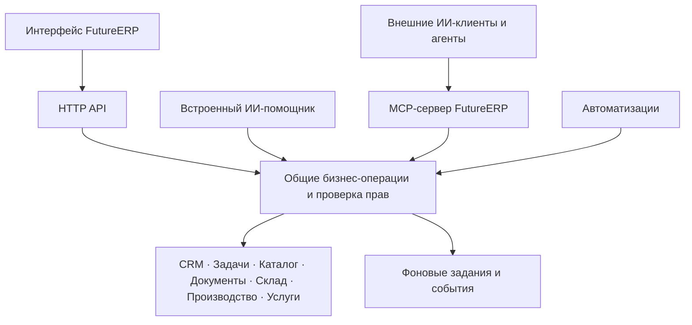

# FutureERP — план развития ИИ-платформы

> **Для исполнителя:** документ фиксирует выбранное архитектурное направление и дорожную карту. Реализация этим обсуждением не запущена. Перед разработкой каждого этапа составить отдельный технический план с точными файлами, контрактами, миграциями и проверками; выполнять согласованный план через `superpowers:executing-plans` или явно выбранный пользователем способ работы.

**Дата:** 2026-10-25.

**Статус:** пользователь выбрал подход № 2 — общий каталог бизнес-операций с MCP поверх него. Разбиение на этапы и детали ниже — предложения для развития; конкретный состав первой версии, сроки и выбор моделей не утверждены.

**Цель:** сделать FutureERP системой, в которой всеми модулями можно управлять через интерфейс, встроенного ИИ-помощника и внешние ИИ-клиенты в пределах доступных операций и выданных прав.

**Архитектура:** общие бизнес-операции служат единым источником правил для HTTP API, автоматизаций и ИИ. Один MCP-сервер публикует инструменты модулей для внешних клиентов. Встроенный помощник использует те же операции через отдельный слой подключения моделей.

**Стек:** развивать существующий Bun / Hono / PostgreSQL / Drizzle / Zod / React / Vite и текущие механизмы jobs, events и автоматизаций. MCP SDK, поддерживаемую версию протокола и механизм подключения моделей выбрать в техническом плане соответствующего этапа.

**Основание требований:** обсуждение с пользователем 2026-10-25; подтверждённые решения перечислены в разделе 1. Текущая архитектура: [обзор](../../architecture.md), [доступ и арендаторы](../../architecture/tenancy.md), [автоматизации](../../architecture/automations.md), [метаданные](../../architecture/metadata.md).

## 1. Подтверждённое направление

- Развивать проект под рабочим названием **FutureERP** с возможностью дальнейшего добавления ИИ-функций. Массовое переименование репозитория и интерфейса в этот план не входит.
- Сделать работу с ИИ сквозной возможностью платформы: все бизнес-модули должны постепенно получать описанные операции, доступные внешним ИИ-клиентам через MCP.
- Не привязывать систему к одному поставщику ИИ; предусмотреть внешние ИИ-приложения и собственных агентов компании.
- **Выбран подход № 2: общий каталог бизнес-операций и MCP поверх него.** Не создавать отдельную бизнес-логику для каждого способа взаимодействия.
- Сохранить этот замысел отдельным планом развития. Начало реализации, конкретный пилот и объём MVP пока не согласованы.

«Любые задачи» означает задачи, составимые из предоставленных инструментов, доступных данных и разрешённых действий. MCP не гарантирует правильность рассуждений модели и не создаёт отсутствующие бизнес-возможности.

## 2. Рассмотренные подходы

| Подход | Польза | Ограничение | Решение |
| --- | --- | --- | --- |
| Обернуть существующий HTTP API в MCP | Быстрый прототип внешнего доступа | Много мелких запросов; правила и права могут оказаться привязаны к HTTP-обработчикам | Допустим как ограниченный исследовательский прототип, но не выбран как целевая архитектура |
| Общий каталог бизнес-операций, адаптеры HTTP / MCP / автоматизаций | Единые правила, расширение по модулям, независимость клиентов | Потребуется последовательно выделить операции из существующей реализации | **Выбран пользователем** |
| Начать со встроенного помощника | Быстрая проверка сценариев внутри продукта | Сам по себе не решает задачу внешней совместимости | Возможный последующий интерфейс над общими операциями |

## 3. Целевая схема

Начать с одного MCP-сервера и групп инструментов по модулям. Каждый модуль регистрирует свои возможности в общем каталоге. Отдельные серверы вводить только при обоснованной необходимости независимого развёртывания или изоляции.

Внешнее ИИ-приложение выступает MCP-клиентом; FutureERP — MCP-сервером. Встроенный помощник самостоятельно обращается к выбранной модели через адаптер провайдера и вызывает общие операции. Подключение модели по API и подключение внешнего клиента по MCP — разные механизмы.

## 4. Общий каталог бизнес-операций

Для каждой операции описывать:

- стабильное имя и версию контракта, модуль, назначение и примеры применения;
- схемы входа и структурированного результата, единицы измерения, валюты и правила дат;
- обязательные права, доступные области данных и ожидаемые побочные эффекты;
- класс действия: чтение, черновик / обратимое изменение, проведение / существенное изменение;
- поддержку предпросмотра, требования подтверждения, идемпотентность и контроль версии записи;
- способ исполнения: синхронно или через фоновое задание; понятные коды ошибок;
- события, создаваемые при успешном исполнении, и сведения для аудита.

HTTP, MCP и автоматизации используют один серверный обработчик операции. Различаются только транспорт и представление результата. Общие схемы и описания могут находиться в `packages/shared`; серверная реализация с доступом к БД не должна попадать во фронтенд.

Перед выделением нового пакета сопоставить существующие доменные функции, HTTP-обработчики и порты `NodeRuntime`; переиспользовать уже вынесенную логику. Точное размещение серверного каталога определить в техническом плане этапа 1 после анализа зависимостей. Не выполнять общий рефакторинг всех модулей за один этап.

Названия ниже иллюстрируют будущие контракты и пока не являются существующим API:

| Модуль | Примеры возможностей |
| --- | --- |
| CRM | Найти компанию / контакт, прочитать историю, создать сделку, изменить её этап |
| Проекты и задачи | Найти проект, создать задачу, назначить исполнителя, изменить срок, учесть время |
| Каталог | Найти товар / услугу, прочитать характеристики, единицы и варианты |
| Продажи и закупки | Прочитать документ, создать черновик заказа, проверить документ, провести его отдельной операцией |
| Склад | Прочитать остатки и движения, рассчитать дефицит, создать резерв |
| Производство | Прочитать спецификацию, рассчитать потребность и себестоимость, подготовить производственный заказ |
| Услуги | Работать с заказ-нарядом, работами, материалами и плановой загрузкой |
| Автоматизации | Читать сценарии и журнал, создавать черновик сценария, отдельно публиковать и запускать его |
| Конструктор сущностей | Узнать схему пользовательской сущности, найти, создать и изменить разрешённые записи |

Целевое правило для новых бизнес-модулей: описанные операции, контекст данных, проверки доступа и контрактные тесты входят в готовность модуля. Не каждый технический endpoint обязан становиться публичным инструментом.

## 5. Контекст, необходимый ИИ

Одних операций недостаточно: агенту нужны описания сущностей, полей, связей, статусов и допустимых переходов. Метаданные конструктора использовать как основу, дополнив их правилами системных модулей.

- Предоставлять поиск с фильтрами, пагинацией, ограничением объёма ответа и идентификаторами исходных записей.
- Для агрегатов сообщать период, фильтры и полноту выборки: частичная страница данных не является итогом всего бизнеса.
- Чётко различать план, факт, резерв, отгрузку, начисление и оплату, где соответствующие понятия существуют в модуле.
- Извлекать связи и текущую структуру пользовательских сущностей во время работы; не требовать ручной интеграции для каждого нового поля.
- Проверять доступ до выдачи данных, включая поля себестоимости, персональные сведения и скрытые / архивные поля конструктора.
- Предоставлять доступные клиенту группы инструментов по его разрешениям; не требовать загрузки всех описаний и всей базы в контекст модели.

Специализированные расчёты выполняются детерминированными функциями ERP; модель выбирает действия и объясняет результат.

## 6. Права и управляемое исполнение

### 6.1. Подключения и авторизация

- У каждого подключения есть владелец или явно определённая служебная идентичность, разрешённый воркспейс, набор возможностей, срок действия и отзыв доступа.
- Для удалённых MCP-клиентов предусмотреть совместимую со спецификацией авторизацию на базе OAuth. Существующая cookie-сессия интерфейса сама по себе не заменяет авторизацию внешнего клиента.
- Эффективный доступ — пересечение прав пользователя / служебной идентичности, разрешений подключения и политики конкретной операции. Проверять его при каждом вызове и перед отложенным исполнением.
- Изоляция арендаторов и RLS сохраняются. Воркспейс проверяется по удостоверенной идентичности и разрешениям; переданный агентом ID не предоставляет доступ.
- Проверять ограничения проектов, записей и полей дополнительно к общим ролям. В описании текущих автоматизаций отмечены ограничения таких проверок; не переносить их автоматически в новый слой.
- Поддержать отзыв подключения и прекращение дальнейших действий ожидающих запусков. Не хранить секреты в промптах и открытых журналах.

### 6.2. Изменения и подтверждения

- Чтение, создание черновика и проведение документа — разные полномочия и операции.
- Для существенных действий предусмотреть серверный предпросмотр и подтверждение в доверенном интерфейсе. Текст модели «пользователь согласен» не считается подтверждением.
- Подтверждение связано с конкретным действием, параметрами, объектами и версиями данных. Существенное изменение данных после предпросмотра требует новой проверки / подтверждения.
- У операций с побочными эффектами есть ключ идемпотентности: повтор с теми же параметрами не создаёт второй документ; повтор ключа с другими параметрами отклоняется.
- Каждая операция сохраняет собственные транзакционные гарантии. Цепочка через несколько модулей не считается одной общей транзакцией: показывать уже выполненные шаги и предлагать предусмотренные доменом корректирующие действия.
- Аудит связывает инициатора, подключение, запуск, инструмент, входные параметры, результат, изменения и подтверждение. Секреты и чувствительные данные маскируются; устанавливается срок хранения.
- Документы и ответы внешних источников считаются данными, а не полномочиями или инструкциями на выполнение операций. Ограничения передачи данных внешним моделям применяются сервером.

Политику «самостоятельно / с подтверждением / запрещено» задавать по возможностям, а не глобальным переключателем полного доступа к ERP. Универсальные SQL, shell и обход доменных правил не входят в бизнес-инструменты.

## 7. Фоновые задания, агенты и автоматизации

MCP предоставляет доступ к действиям, но постоянная автономная работа требует исполнителя, который реагирует на события, расписание или команду пользователя.

- Переиспользовать существующие `jobs`, outbox `events` и инфраструктуру автоматизаций там, где они обеспечивают нужные гарантии.
- Для длительных операций возвращать идентификатор задания, доступный статус, результат и ошибку; предусмотреть остановку дальнейших шагов.
- Сохранять состояние между шагами и перезапусками; повторять временные ошибки с ограничением попыток и задержкой. Для внешних эффектов использовать идемпотентность, не обещать глобальное «ровно один раз».
- Проверять права и актуальность подтверждения перед возобновлением; отзыв доступа не должен обходиться уже поставленной задачей.
- Ограничивать время, шаги, число вызовов инструментов и расходы на модель. Лимиты устанавливаются политикой воркспейса.
- Поддержать ожидание подтверждения, видимый журнал и защиту от циклов событий между автоматизациями и ИИ.

Встроенный исполнитель и независимый внешний агент — два допустимых способа оркестрации. Отдельный новый движок не является обязательным условием первого MCP-пилота.

## 8. Подключение моделей и встроенный помощник

Адаптер моделей должен позволять сменить провайдера без переписывания бизнес-модулей. Описывать фактические возможности модели: вызовы инструментов, структурированные ответы, контекст, лимиты и стоимость; не считать всех провайдеров взаимозаменяемыми без проверки.

Встроенный помощник использует те же операции, права и аудит, что внешние подключения. В интерфейсе доступны ссылки на записи, результаты действий, предпросмотр и подтверждение, состояние фонового задания.

Поддержка API-ключей клиента, локальных моделей, конкретных поставщиков, политики хранения переписки и размещения данных требует отдельных решений. Не выбирать провайдера автоматически на основании этого документа.

## 9. Этапы развития и критерии готовности

Порядок ниже рекомендован автором плана. Все пункты пока не выполнены; календарные сроки и трудоёмкость не оценены.

### Этап 1. Общие операции на одном вертикальном сценарии

- [ ] Составить карту существующих бизнес-операций, проверок прав и дублирования между API и автоматизациями.
- [ ] Выбрать пилотные действия чтения и создания черновика; описать контракты, идентичность исполнителя и модель ошибок.
- [ ] Создать каталог и адаптировать выбранные HTTP-обработчики и соответствующие действия автоматизаций к общему исполнению.
- [ ] Проверить равенство результата, прав, валидации, аудита и событий при разных способах вызова; проверить изоляцию воркспейсов.

**Готовность:** один завершённый сценарий использует общие бизнес-операции без дублирования правил, существующий интерфейс продолжает работать.

### Этап 2. Внешний MCP-пилот: чтение и черновики

- [ ] Реализовать MCP-адаптер каталога, авторизацию и отзыв подключений, разрешения чтения / создания черновиков.
- [ ] Предоставить поиск, метаданные и ограниченный набор инструментов пилотного сценария.
- [ ] Добавить учёт вызовов, ограничения объёма и частоты, защиту от повторной записи и фильтрацию чувствительных полей.
- [ ] Проверить подключение выбранных внешних клиентов; для подтверждения независимости использовать два независимых MCP-клиента.
- [ ] Проверить запрет чужого воркспейса, закрытого проекта, отозванного доступа и проведения документа без разрешения.

**Готовность:** внешний клиент читает разрешённые данные и создаёт прослеживаемые черновики; повтор запроса не дублирует запись. Список совместимых клиентов фиксируется по результатам проверки.

### Этап 3. Межмодульное покрытие и пользовательские данные

- [ ] Подключать CRM, проекты / задачи, каталог, документы, склад, производство и услуги отдельными проверяемыми приращениями.
- [ ] Добавить разрешённые операции пользовательских сущностей с динамическими схемами и валидацией связей.
- [ ] Подключить чтение автоматизаций и подготовку их черновиков; публикацию и запуск включать после этапа 4.
- [ ] Для каждого модуля зафиксировать матрицу: доступные действия, права, последствия, тесты и ещё не поддержанные операции.
- [ ] Проверить сквозной сценарий заказа, остатков, дефицита и черновиков закупки / производственных задач.

**Готовность:** агент может выполнить выбранный межмодульный сценарий без обхода доменных правил, а добавление поля пользовательской сущности не требует ручной правки коннектора.

### Этап 4. Проведение и другие существенные действия

- [ ] Реализовать политику подтверждений, предпросмотр и связь согласия с параметрами и версиями данных.
- [ ] Добавлять проведение документов, резервы, публикацию автоматизаций и другие действия отдельными полномочиями по мере проверки доменных гарантий.
- [ ] Проверить повтор проведения, конкурентное изменение, устаревший предпросмотр, отказ / истечение подтверждения и частичный успех цепочки.
- [ ] Проверить полный путь согласования, исполнения и аудита через внешний клиент и доверенный интерфейс ERP.

**Готовность:** существенное действие исполняется только в рамках актуальных серверных разрешений и установленной политики подтверждений; результаты и последствия доступны пользователю.

### Этап 5. Встроенный помощник и сменяемые модели

- [ ] Выбрать провайдеров для пилота и реализовать адаптер с явными возможностями, лимитами и учётом расходов.
- [ ] Добавить интерфейс помощника с контекстом текущей записи, ссылками на источники, результатами действий и подтверждениями.
- [ ] Использовать общий каталог без отдельных привилегированных путей записи.
- [ ] Проверить выбранные сценарии на двух моделях, отсутствие расширения прав и корректное сообщение об ошибке провайдера.

**Готовность:** пользователь выполняет те же разрешённые сценарии внутри ERP; смена поддерживаемой модели не требует изменения модулей.

### Этап 6. Длительные и событийные ИИ-процессы

- [ ] Добавить сохраняемые запуски, ожидание подтверждения, восстановление, остановку дальнейших шагов и журнал.
- [ ] Подключить запуск по событию / расписанию с лимитами, защитой от циклов и повторной проверкой доступа.
- [ ] Проверить перезапуск воркера, повтор доставки события, таймаут провайдера, исчерпание бюджета, отзыв прав во время ожидания и частичное выполнение.
- [ ] Проверить полный сценарий от события до результата с возможностью понять и остановить дальнейшую работу агента.

**Готовность:** процесс переживает перезапуск, не дублирует учтённые изменения, останавливается по политике и показывает выполненные и ожидающие шаги.

## 10. Приёмочные сценарии

| Сценарий | Ожидаемый результат |
| --- | --- |
| «Какие заказы задерживаются и почему?» | Ответ по доступным данным со ссылками, периодом и явным указанием недостающих сведений |
| «Подготовь заказ по письму клиента» | Извлечённые данные сопоставлены с каталогом; неоднозначности показаны; создан черновик, а не проведённый документ |
| «Проверь материалы по заказу и подготовь закупку недостающего» | Потребность рассчитана ERP с учётом правил остатков / резервов; подготовлены связанные черновики; неоднозначности не подменены догадками |
| «Когда сделка выиграна, создай проект и назначь ответственного» | Подготовлен проверяемый черновик сценария; публикация и запуск подчиняются отдельным правам и политике |
| «Повтори предыдущую команду после обрыва связи» | Клиент получает результат уже учтённой операции либо понятный статус; второй документ не появляется |
| «Выполни ту же задачу из другого ИИ-клиента» | Действуют те же бизнес-правила и разрешения; происхождение вызова видно в журнале |

Это целевые сценарии развития, а не утверждение о наличии указанных функций сегодня.

## 11. Контрольные риски для технических планов

1. Доступ к чужому воркспейсу, закрытому проекту или чувствительному полю: запрет применяется сервером ко всем адаптерам, включая фоновое исполнение.
2. Повтор команды после сетевого сбоя: один бизнес-эффект, проверяемый ключ идемпотентности, восстановимый результат.
3. Изменение данных между предпросмотром и действием: устаревшее подтверждение не применяется к новым последствиям.
4. Вредоносная инструкция внутри документа: содержимое не расширяет права и не разрешает передачу закрытых данных.
5. Частичный успех цепочки и перезапуск исполнителя: сохранённые результаты, понятный статус, отсутствие обещания общего отката, контролируемое продолжение.

Каждый риск должен получить негативный тест в техническом плане этапа, который вводит соответствующую возможность. Проверки доступа начинаются на этапе 1, повторы — на этапе 2, подтверждения — на этапе 4, устойчивость автономного исполнения — на этапе 6.

## 12. Решения перед реализацией

- Выбрать первый пилот: внешний MCP-клиент, встроенный помощник или иной согласованный порядок. Рекомендация этого плана — внешний доступ к чтению и черновикам.
- Выбрать конкретный пользовательский сценарий и достаточный для него набор операций; не открывать все модули одновременно.
- Определить владельцев подключений, необходимость служебных идентичностей и матрицу разрешений.
- Определить правила подтверждения по действиям, допустимые внешние модели и передачу им бизнес-данных.
- Определить размещение и авторизацию MCP-сервера, проверяемых клиентов, лимиты, сроки хранения журналов и порядок отзыва доступа.
- Согласовать критерии качества на примерах пилота; оценивать не только ответы, но и корректность действий, стоимость и число подтверждений.
- Уточнить размещение общего серверного слоя по фактическому графу зависимостей. Зафиксировать точные файлы, миграции и интерфейсы в техническом плане этапа 1.

## 13. Источники по протоколу

- [MCP: инструменты](https://modelcontextprotocol.io/specification/2026-07-28/server/tools).
- [MCP: авторизация](https://modelcontextprotocol.io/specification/2026-07-28/basic/authorization).

Ссылки отражают материалы, использованные в обсуждении. Перед реализацией проверить актуальность протокола, SDK и совместимость выбранных клиентов; версия в ссылке не является обязательным выбором зависимости.
